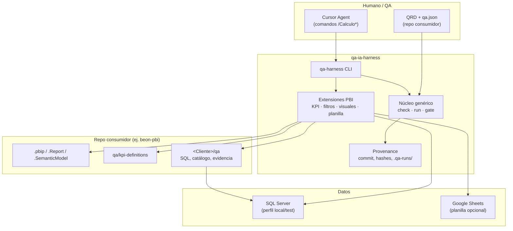
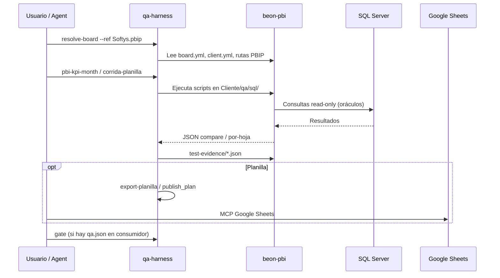

# Arquitectura — qa-ia-harness

Este documento describe cómo encajan la CLI, los repos consumidores (por ejemplo **beon-pbi**) y el rol opcional de Cursor.

## Vista general

## Flujo típico — tablero Power BI (Softys u otro)

## Principios

| Idea | Detalle |
|------|---------|
| Sin reglas de negocio en el núcleo | KPI, scope y catálogo viven en **beon-pbi** (`qa/`, `<Cliente>/qa/`). |
| Sin IA en la ejecución | Los comandos son deterministas; Cursor solo orquesta y documenta. |
| Evidencia fuera de Git | Salidas en `.qa-runs/` o `test-evidence/` según el flujo. |
| Perfiles locales | `.qa-profiles.local.json` enlaza harness ↔ framework SQL ↔ cada tablero. |

## Módulos Python (mapa rápido)

Ver `src/qa_harness/README.md` para el detalle por archivo.

## Documentación relacionada

- [Contrato y CLI](contract.md)
- [Integración Cursor](../integrations/cursor/README.md)
- Repo consumidor **beon-pbi**: `qa/README.md` y `Softys/qa/README.md` (mismo workspace multi-root).
